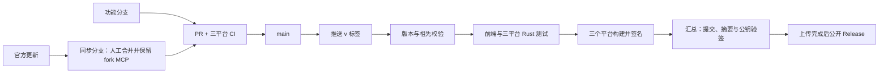

# fork 的 GitHub 开发、上游同步与发布流程

适用仓库：`iamsxm/kojoomail`。官方来源：`ekoouu/kojoomail`。首次独立发布版本准备为 `0.4.0`，没有自动创建该标签或公开 Release。

## 1. 分支和 PR

`main` 是可以发布的 fork 稳定分支。日常工作从最新 `fork/main` 开功能分支，通过 PR 和 CI 后合入。功能 PR 可 squash；上游同步 PR **必须用 Create a merge commit**，保留官方 ancestry。

本地 remote 目前是 `origin=官方`、`fork=自己的仓库`。不要不看 remote 就执行 `git push origin`。GitHub Actions 的 checkout 内部 `origin` 则指当前 fork，发布脚本据此校验 `origin/main`。

```powershell
git fetch fork
git switch -c codex/my-feature fork/main
# 修改、测试、提交
git push -u fork codex/my-feature
gh pr create --repo iamsxm/kojoomail --base main
```

建议 `main` 的保护配置：要求 PR、要求 `required` 检查通过、禁止强推和删除；个人仓库允许零个必需审批，避免自己无法审批自己。不要启用 require linear history，因为同步上游需要 merge commit。保留仓库的 merge 和 squash 按钮。

首次集成 PR 同时包含原 MCP 功能分支、本地后续修复、官方 0.3.2 合并和本次流水线，必须采用 merge commit。官方合并记录见 `upstream-0.3.2-merge-plan.zh-CN.md`。

## 2. 每种工作流做什么

| 工作流 | 触发 | 结果 |
|---|---|---|
| `ci` | PR、main 和常用开发分支 push；也可被 release 复用 | 前端构建/测试、版本配置校验、Windows x64 与 macOS arm64/x64 Rust workspace 测试；汇总为 `required` |
| `build-desktop` | 手动运行、`ci/**` 分支 push，或 release 调用 | 构建对应架构 MCP 代理、主程序和安装包，校验/归集后上传 Actions artifacts；普通运行不签 updater、不公开 Release |
| `release` | 推送 `v*` 标签；手动输入已有标签可重试 | 校验标签及 main ancestry → 全量 CI → 三平台签名构建 → 汇总验签 → 上传 → 自动公开 |
| `upstream-report` | 手动 | 抓取官方 main，生成未合入提交、文件、重点共享文件报告；不自动合并 MCP |

没有定时同步或自动合并官方代码。GitHub Actions 依赖固定到经核对的提交 SHA；Dependabot 每周提出 Actions 升级 PR。



## 3. 独立版本与签名

fork 使用自己的版本序列，不随官方版本号回退。例如 fork 为 `0.4.0` 时合入官方 `0.3.3`，下一次 fork 发布仍按自身计划升到 `0.4.1` 或 `0.5.0`。官方来源记录在 `upstream-state.json`，数据库当前 fork v5 与官方 v4 也分别记录。

统一改版本：

```powershell
npm run release:version -- 0.4.1
npm run release:check
npm test
```

脚本同时更新 package、npm 锁文件、Tauri 配置、应用和 MCP 代理 Cargo manifest、Cargo 锁文件。版本支持 `X.Y.Z` 与 `X.Y.Z-alpha.N` / `beta.N` / `rc.N`；前三段限制为 0..65535，避免 Windows 安装器数字溢出。标签必须精确为 `v` 加版本；稳定版必须高于已有 latest。

fork updater 配置固定为：

```text
https://github.com/iamsxm/kojoomail/releases/latest/download/latest.json
```

公钥已写入 `src-tauri/tauri.conf.json`。本机加密私钥、密码分别位于 `.local/release-signing/updater.key`、`.local/release-signing/password`，均被 Git 忽略。已用 Tauri CLI 实际签名并验签。**请把整个签名目录离线备份**；Actions Secret 无法下载恢复私钥，换一台机器应恢复备份，不要生成新密钥。

`scripts/setup-updater.mjs` 可恢复配置并用 stdin 上传 Secret，不在命令或日志中打印密钥。配置已是 fork 公钥而本地缺少原密钥时，它会拒绝生成替代密钥，避免中断已安装用户的更新。

| GitHub 配置 | 类型 | 必需性 |
|---|---|---|
| `TAURI_SIGNING_PRIVATE_KEY` | Secret | 正式构建必需；已配置 |
| `TAURI_SIGNING_PRIVATE_KEY_PASSWORD` | Secret | 本次密钥已加密，已配置 |
| `KOJOOMAIL_GOOGLE_CLIENT_ID` | Variable | Gmail OAuth 可选 |
| `KOJOOMAIL_GOOGLE_CLIENT_SECRET` | Secret | Gmail OAuth 可选，桌面客户端编译后仍可提取，见 `oauth-setup.md` |
| `KOJOOMAIL_MS_CLIENT_ID` | Variable | Outlook OAuth 可选 |
| `APPLE_CERTIFICATE`、`APPLE_CERTIFICATE_PASSWORD` | Secret | Apple Developer 代码签名可选；证书为 base64 编码 p12 |
| `APPLE_SIGNING_IDENTITY` | Variable | Apple Developer 签名身份；未配置则沿用 ad-hoc 签名 `-` |
| `APPLE_ID`、`APPLE_PASSWORD` | Secret | Apple 公证可选；后者使用应用专用密码 |
| `APPLE_TEAM_ID` | Variable | Apple 公证配套团队 ID |

updater 签名与 Apple/Windows 系统代码签名是不同层。本次配置 updater 签名；没有 Apple Developer 证书/公证时，macOS 首次打开可能需要到「系统设置 → 隐私与安全性」允许，更新后钥匙串也可能重新询问。Windows 没有 Authenticode 证书时会显示未知发布者。缺少 OAuth 配置时 Gmail 使用应用专用密码，Outlook 一键登录不启用；不能把缺省安装包描述成已具备 OAuth。

首次安装 fork 需要手动安装本 fork 的安装包，官方旧包只信任官方公钥，不能通过官方自动更新通道迁移过来。此后的 fork 自动更新才使用本次公钥和地址。

## 4. 发布步骤

先通过版本 PR 将目标版本合入 `main`，并确认 Actions 通过。版本修改属于可审阅源码；不要临时在未提交的目录里打一个不同版本的包。

```powershell
git fetch fork
git switch -c codex/release-0.4.0 fork/main
npm run release:check -- v0.4.0
git tag -a v0.4.0 -m 'Kojoo Mail fork v0.4.0'
git push fork v0.4.0
```

`v0.4.0` 已在本次源码中准备好，等集成 PR 合入 main 后执行上述步骤；新版本先用 `release:version` 改版本并通过 PR。本地创建的发布分支只是指向最新 main，不需要额外空提交。

正式发布具体约束：

1. 标签必须存在，标签版本、所有 manifest/锁文件、实际检出提交一致；目标提交必须已在 fork main 历史内。
2. 已公开的相同标签不覆盖；修复应发布新版本。失败后可重跑失败任务或手动指定原标签，尚未公开的草稿可恢复上传。
3. 每个平台先编译 MCP bridge，再把带 target triple 的 sidecar 放进 `src-tauri/binaries`，然后 Tauri 打包。
4. 所有构建记录必须来自同一源码提交、同一版本；文件集合、SHA256 和真实 Minisign 签名全部校验通过。
5. 只有 publish job 有 `contents: write`。构建和测试任务只读；PR 不接触发布私钥。
6. publish 在全部平台成功后创建临时草稿并上传全部文件，上传成功立即公开。临时草稿是防止半成品公开的技术步骤，无需人工点击发布。上传失败只留下可恢复的草稿。
7. alpha/beta/rc 标签公开为 prerelease，并设置 `latest=false`；不会替换稳定版自动更新入口。

安装/更新产物：

| 平台 | 下载安装 | updater |
|---|---|---|
| Windows x64 | `KojooMail_<version>_windows_x86_64_setup.exe` | 同一 `.exe` 和 `.exe.sig` |
| macOS Apple Silicon | `KojooMail_<version>_macos_aarch64.dmg` | `.app.tar.gz` 和 `.sig` |
| macOS Intel | `KojooMail_<version>_macos_x86_64.dmg` | `.app.tar.gz` 和 `.sig` |

Release 同时附 `latest.json` 与 `SHA256SUMS.txt`。JSON 包含 `windows-x86_64`、`darwin-aarch64`、`darwin-x86_64` 三个平台，signature 为 `.sig` 内容而非文件路径，下载 URL 固定到对应版本标签。macOS 安装包内主程序和 MCP 代理均验证目标架构和 codesign。

本地也可运行 `node scripts/build-local.mjs`，使用当前 rustc host target 构建；`build-installer.sh` / `build-mac.sh` 是它的薄封装。脚本先准备 MCP 代理，再调用与 CI 相同的打包和收集步骤；存在本地签名备份时生成并验证更新签名，否则只生成预览安装包。需要先 `npm ci`，并安装对应 Rust target、Windows C++ 或 macOS Xcode 构建工具。

## 5. 今后合并官方功能

先在 GitHub 手动运行 upstream-report，或本地：

```powershell
git fetch origin
npm run upstream:report -- origin/main
```

本地 `origin` 是官方；若你的 remote 命名不同，替换为实际官方 remote。报告在 `release-assets/upstream-report.md`。确认目标提交后，从 fork main 开同步分支：

```powershell
git fetch fork
git switch -c codex/sync-upstream-YYYYMMDD fork/main
git merge --no-ff --no-commit <官方目标提交>
# 逐块处理冲突，继续使用 fork MCP
npm run release:check
npm test
npm run build
cargo test --locked --workspace --manifest-path src-tauri/Cargo.toml
# 更新 docs/upstream-state.json 的官方来源、版本和数据库版本
git add <本次已审阅文件>
git commit
git push -u fork codex/sync-upstream-YYYYMMDD
gh pr create --repo iamsxm/kojoomail --base main
```

不要用 ours 合并策略把全部官方更新伪装成已合入，也不要整份覆盖共享文件。`mcp.rs` 等独立 MCP 文件保留 fork 实现，但 commands/settings/store/lib/前端 store/Settings 中的新功能必须逐块接入。默认忽略官方 MCP 的不同实现，保留 fork 读/写/发三轴和桌面确认。

数据库迁移必须按 fork 自身序号末尾追加，不能照搬官方编号、改写已发布迁移或只凭版本号判断结构；补充旧 fork 和官方来源库的升级、备份、重复打开回归测试。普通发送、MCP 草稿/发送、会话/规则与移动回滚的组合测试也要继续通过。

合并 PR 用 `gh pr merge <编号> --repo iamsxm/kojoomail --merge` 或网页 Create a merge commit。没有新的业务变更时不要重写历史；官方以后再次修改已排除 MCP 文件，Git 仍会出现差异或冲突，需要重复审阅。

## 6. 故障处理

- 标签版本不一致或不在 main：先完成版本 PR，不移动已公开标签。错误标签且尚未发布时，由维护者核实后处理；脚本不会自动删除标签。
- 三平台任一失败：不会进入 publish；打开失败任务修复并用新提交/新版本，或在环境故障时重试原标签。
- 签名失败：恢复与已提交公钥匹配的 `.local/release-signing` 备份，再执行 `node scripts/setup-updater.mjs --upload`。不要把私钥贴到 Issue/PR。
- 上传失败留草稿：重跑 publish 或原标签流程，成功后才公开。
- 已公开版本有 bug：发布更高的修复版本；不要覆盖同名安装包或让 latest 回退。旧程序不能打开 fork v5 数据库，涉及回滚要使用升级前备份和相应版本程序。

## 参考

- Tauri updater：https://v2.tauri.app/plugin/updater/
- Tauri sidecar：https://v2.tauri.app/develop/sidecar/
- GitHub Actions 权限：https://docs.github.com/en/actions/reference/workflows-and-actions/workflow-syntax#permissions
- GitHub runner 环境：https://github.com/actions/runner-images

runner 和 Actions 版本于 2026-11-13 查询官方仓库：macos-15 为 arm64，macos-15-intel 为 x64；Windows 使用 windows-2025。之后升级由 Dependabot PR 与实际构建验证。
